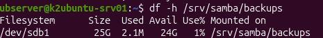

# Dokumentation Victors branch

## Linux-installation

En Linux server installeras som kör Ubuntu Desktop 26.04 LTS (Long-Term Support) vilket är ett stabilt och uppdaterat operativsystem.
Den virtuella maskinen blev tilldelad 2 CPUs, 8GM minne, 40GB för lagring. Nätverksadaptern är satt till NATNetwork så den simulerar ett internet nätverk så att flera maskiner kan kommunicera.

Vid installation väljer jag inga extra program för att hålla storleken nere, samt att detta hjälper att skydda maskinen med att inte ha onödiga tjänster igång som kan vara sårbara. Jag kommer installera tjänster eftersom de behövs. Nätverk ställer jag in efter installationen så den har en statisk IP-adress.

Ubuntu-servern är installerade med olika partioner, detta för att göra systemet lite mer säkert vid lagringsfel, om t.ex. bootloader går sönder behöver man bara formattera om den delen så ingen data går förlorad på andra partioner.

### Partitioner:

/boot/efi
FAT32/VFAT
Storlek: Automatiskt satt (1,13GB)
Huserar UEFI bootloader

/boot
ext4
Storlek: 1GB
Lagring för Linux Kernel (kärnan)

/var
ext4
Storlek: 10GB
Systemloggar, webbserver

/tmp
ext4
Storlek: 2GB
Temporära filer

/
ext4
Storlek: Resterande (27GB)
Innehåller resterande systemfiler, program etc.

Hostname: k2ubuntu-srv01
Användarnamn: ubserver
Lösenord: xxxxxxx

Region och tidszon är Stockholm, systemspråket är engelska för att förenkla installation, konfigurering och felsökning då engelska är standardspråk för detta. Tangentbordslayour är svenskt för att spegla de fysiska tangentbord vi använder.

## Nätverk och uppdateringar, installation av nginx

Efter installationen satte statisk IP-adress genom att ändra i netplan-filen `sudo nano /etc/netplan/00-installer-config.yaml`. IP-adressen är 192.168.50.10/24 (subnätmask 255.255.255.0) med Gateway 192.168.50.1 (NATnetwork host) så att den har internettillgång, DNS-server är satt till 8.8.8.8 vilken är Googles publika DNS-server.

Körde kommandot `sudo apt update && sudo apt upgrade -y` för att hämta och installera nya uppdateringar för systemet, detta för att säkra och stabilisera systemet så att den är uppdaterad.

Sen installerade jag nginx `sudo apt install nginx` som är en snabb, stabil och säker webbserver som ska köras på denna server. Jag verifierade att webbservern är tillgänglig med att testa från lokala servern genom att gå till localhost i Firefox, bekräftade även med en annan dator på nätverket genom att gå till 192.168.50.100 i webbläsaren där.

### Backup-disk

För att husera backup från vår Windows Server skapade jag en ny disk för att montera på /var/samba/backups på 25GB.

För att skapa en partition på disken måste vi först veta vad den är identiferad som i systemet. Kör `lsblk` så dyker en ny disk upp som står som "/dev/sdb" För att skapa en partition kör kommandot `sudo fdisk /dev/sdb`. Fdisk är ett interaktivt verktyg som hanterar partioner, skriv in `n` för ny och tryck enter. Tryckte enter på restkommande frågor för att köra på default (primär partion, använda hela disken).

Sedan formatera och skapa en etikett för den så vi kan enkelt identifiera disken kör kommandot `sudo mkfs.ext4 -L BACKUP /dev/sdb1`. Ext4 är filsystemet och ger den etiketten BACKUP.

För att få den att automatiskt monteras vid uppstart så måste man lägga in den i /etc/fstab, dock måste man hitta UUID:t för den så kör kommandot `sudo blkid /dev/sdb1`, UUID för den är `d65d163e-dc32-4ff7-8284-092b315aa90f`.

För att redigera /etc/fstab använder jag Nano som är inbyggt och lägger till följande rad längst ner: `UUID=d65d163e-dc32-4ff7-8284-092b315aa90f  /srv/samba/backups  ext4  defaults,nofail  0  2`

Kolla så den monterades korrekt med `df -h /srv/samba/backups`:

Se **3 Behörigheter och fildelning** för fullständig Samba-konfiguration.