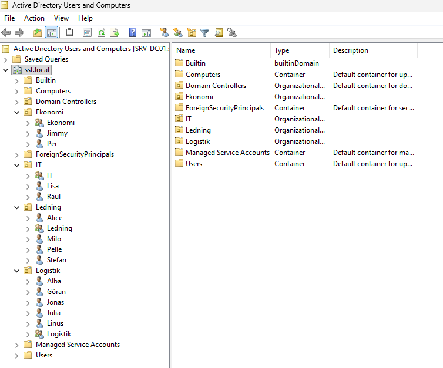

# Windows och AD

## Installation 

Den virtuella maskinen är tilldelad 2 virtuella CPU:er, 8GB RAM för en smidig prestanda och 60GB lagring för att ha tillräckligt med utrymme för operativsystemet samt tjänster och framtida program. Operativsystemet är Windows Server 2025 som är den senaste versionen av Windows Server. Systemspråket är engelska av standard som hjälper vid felsökning och inställningar. Tangentbordslayouten är svenska för att spegla fysiska tangentbord då specialtecken kan komma att användas.

Efter installationen av Windows Server var klar så lade jag till tjänsten Active Directory Domain Services (AD DS) som är en databas som förenklar användar- och resurshantering på nätverket.

### Koppling till extern backup-disk

Vår Ubuntu-server ska agera filserver för backups från Windows Servern. På Linux är Samba-utdelningen redan skapad 

## Active Directory

### OU:s, användare och grupper

Vid installation av AD DS så skapar man en domän för företaget. Domänen är döpt till sst.local som är förkortning av Skämt & Sido Transport. Detta namnet är bara adminstrativt och har ingen effekt utanför nätverket.

De anställda har blivit uppdelade i olika grupper för att ha en bättre och enklare översikt när det kommer till rättigheter och åtkomst. Istället för att sätta rättigheter per anställd så sätts det på gruppnivå. Alla anställda är indelade i grupper, samma struktur som på Ubuntu-servern:

* Ledning
* Ekonomi
* Logistik
* IT

I Active Directory kan man då sätta rättigheter via grupperna för t.ex. fildelning (utdelningar) samt skrivare. Men ett annat sätt att styra vad de anställda får eller inte får göra är med GPO (Group Policy Objects) som sätts på Organizational Units (OU). Varje OU innehåller respektive grupp samt användare för den avdelningen:
```
sst.local (domän)
├── Ledning OU
|   ├── Ledning (grupp)
|   └── Användare
├── Ekonomi OU
|   ├── Ekonomi (grupp)
|   └── Användare
├── Logistik OU
|   ├── Logistik (grupp)
|   └── Användare
└── IT OU
    ├── IT (grupp)
    └── Användare
```
Skärmbild Active Directory OU- och gruppstruktur:


### Gruppolicys

Med GPO:er kan man göra sätta omfattande inställningar och policyes t.ex. ställa in så användare inte får tillgång till kommandotolken, kontrolpanelen eller ändra bakgrund. Detta för att öka säkerheten både för domänen/företaget men även för själva datorn. 

För att sätta en övergripande standard för alla användare på domänen använder jag mig utav standard GPO:n som heter Default Domain Policy eftersom denna är redan skapad och applicerad på alla användare i domänen.

Jag följer CIS Benchmark för Windows Server 2025 som rekommenderar ett flertal policys för lösenord- och kontohantering.

I verktyget Group Policy Management, högerklicka på Default Domain Policy Edit. Gå till Computer Configuration → Policies → Windows Settings -> Security Settings -> Account Policies

#### Password Policy

Enforce password history (CIS Recommendation 1.1.1)

Har jag kvar som standard, att den kommer ihåg de senaste 24 lösenorden så inte samma lösenord används om och om igen.

Maximum password age (CIS Recommendation 1.1.2)

Ändrad från 42 till 90 dagar. Om användare byter lösenord för ofta kan det vara svårt att komma ihåg dem, samt att de kanske väljer enklare lösenord.

Minium password age (CIS Recommendation 1.1.3)

Lämnar kvar det på 1 så man inte kan byta lösenord direkt efter man redan bytt, utan måste vänta en dag minst.

Minimum password length (CIS Recommendation 1.1.4)

Standard är 7 dagar, jag ändrar till 14 efter CIS Benchmark så vi kräver längre lösenord.

Resten lämnar vi default, t.ex. Password Complexity då vi ska kräva att lösenorden ska innehålla stora och små bokstäver, siffror och/eller karaktärer som hjälper till att göra lösenordet starkare

#### Account Lockout Policy:

Account lockout duration (CIS Recommendation 1.2.1)

Satt till Enabled så att konton blir låsta i 15 minuter om antal inloggningsförsök överskrids.

Account lockout threshold (CIS Recommendation 1.2.2)

Satt till 5 försök innan kontot blir låst.

Allow Administrator account lockout (CIS Recommendation 1.2.3)

Satt till Enabled, gör så att det inbyggda Admin-kontot också kan bli låst, ger starkare skydd mot attacker mot den lokala datorn.

Reset account lockout counter after (CIS Recommendation 1.2.4)

Satt till samma som Account lockout duration, 15 minuter enligt CIS Benchmark. Tiden efter att konto-låsningen återställs.

Med dessa policies satta uppnår vi flera mål i IG1 och även i IG2 för att säkra domänen.