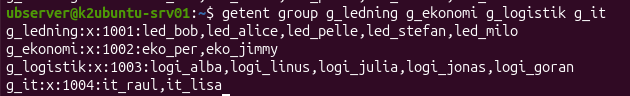
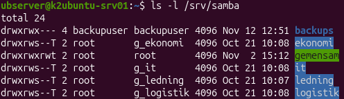

# Behörighet och fildelning

Företaget är uppdelat i olika avdelningar beroende på deras anställning och ansvarsområde. Dessa avdelningar består av en ledning, ekonomi, logistik och IT. Varje avdelning har en tilldelad mapp som de jobbar med där viktiga filer kan laddas upp och alla i gruppen har åtkomst till. De kan enkelt lägga till och ändra filer men inte ta bort varandras filer (Sticky bit). Det finns också en gemensam mapp för hela företaget som alla avdelningar har åtkomst till, här ligger filer som rör alla anställda.


## Grupper

På Linux-servern skapar jag alla grupper för de olika avdelningarna, detta möjliggör enklare hantering av användare, rättigheter och fildelning.

Följade grupper är skapade:
* Ledning: g_ledning
* Ekonomi: g_ekonomi
* Logistik: g_logistik
* IT: g_it

Grupper Ubuntu:



## Mappstruktur och rättigheter

Som nämnt ovan har varje avdelning en tilldelad nätverksmapp som varje användare i respektive avdelning har åtkomst till. Varje medlem i avdelningen får lägga upp och redigera filer som de gemensamt jobbar med. Till slut finns en gemensam mapp där alla anställda på företaget kan komma åt.

Mappstruktur:
* Ledning - /srv/samba/ledning
* Ekonomi - /srv/samba/ekonomi
* Logistik - /srv/samba/logistik
* IT - /srv/samba/it
* Gemensam - /srv/samba/gemensam

Ägare av mapparna kommer vara root:avdelning, eftersom anställda är medlemmar i avldelningarna kommer de ha tillgång:

`sudo chown root:<avdelning> /srv/samba/<mapp>`
 
På varje mapp har jag satt 3770, detta för att sätta Sticky Bit så att andra inte kan ta bort dina filer och SetGID för att nya filer/mappar ärver gruppens ägandeskap från huvudmappen. Ägaren och gruppen har fulla rättigheter medan övriga har inga rättigheter alls. Den som skiljer sig är Gemensam där jag satt 1777 så alla har fulla rättigheter men bara ägaren/root kan ta bort filer.

`sudo chmod 3770 /srv/samba/<avdelning>`

`sudo chmod 1777 /srv/samba/gemensam`

Backups-utdelningen är lite speciell där en användare (backupuser) är skapad för att vara ägare som också finns på Window-servern, detta för att kunna koppla utdelningen för att ta backups hit.

`sudo chown backupuser:backupuser /srv/samba/backups`

`sudo chmod 770 /srv/samba/backups`

Rättigheter Samba-utdelningar:



## Fildelning med Samba

För att erbjuda nätverksfildelning kör vi Samba på Ubuntu-servern som hanterar att dela och ut och hantera åtkomst. Installera Samba med: 

`sudo apt install samba`

Inställningarna för Samba finns i filen /etc/samba/smb.conf där alla utdelningar ställs in:

``` bash
[Gemensam]
   comment = Gemensam delning
   path = /srv/samba/gemensam
   browsable = yes
   writable = yes
   guest ok = yes
   read only = no

[Ledning]
   comment = Ledning delning
   path = /srv/samba/ledning
   browsable = yes
   writable = yes
   read only = no
   valid users = @g_ledning

[Ekonomi]
   comment = Ekonomi delning
   path = /srv/samba/ekonomi
   browsable = yes
   writable = yes
   read only = no
   valid users = @g_ekonomi

[Logistik]
   comment = Logistik delning
   path = /srv/samba/logistik
   browsable = yes
   writable = yes
   read only = no
   valid users = @g_logistik

 [IT]
   comment = IT delning
   path = /srv/samba/it
   browsable = yes
   writable = yes
   read only = no
   valid users = @g_it

[Backups]
   comment = Backup delning
   path = /srv/samba/backups
   browsable = yes
   writable = yes
   read only = no
   valid users = backupuser
```

Där path är vägen till mappen på servern, browseable är att man kan gå in och titta, writable så att man kan skriva (ladda upp), read only är satt till no eftersom man ska kunna skriva och valid users är satta till gruppen för just den delningen, detta för att kontrollera åtkomsten så bara användare som tillhör den gruppen får gå in på delningen. Den som skijer sig är gemensam-mappen där guest är satt till ja så att alla får tillgång.