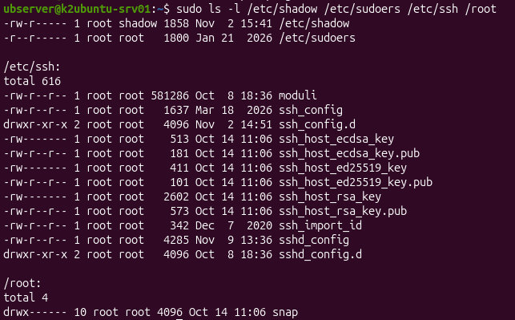
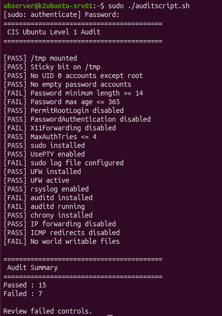

# Härdning

## Linux

### Behörigheter

Även om känsliga mappar och filer är säkra av standard kan det vara bra att dubbelkolla viktiga filer och mappar, t.ex. /etc/shadow, /etc/sudoers, /root samt /etc/ssh där SSH-nycklar ligger. Dessa ska ha 640 eller 600 då bara root ska ha tillgång till dessa.

Kör nedan kommando för att lista /etc/shadow, /etc/sudoers, /etc/ssh samt /root-katalogerna:

` sudo ls -l /etc/shadow /etc/sudoers /etc/ssh /root`



### Automatiska uppdateringar

För att säkerställa att systemet är uppdaterat med de senaste patcherna är det bra att dubbelkolla så att automatiska uppdateringar är igång, kolla med kommandont `cat /etc/apt/apt.conf.d/20auto-upgrades `

Resultatet blir
```
APT::Periodic::Update-Package-Lists "1";
APT::Periodic::Unattended-Upgrade "1";
```
Där 1 betyder att systemet kör `apt update` och `apt upgrade` automatiskt dagligen. Ändra till 0 för att stäng av eller till 2 för att det ska köras varannan dag.

### Brandvägg 
Jag använder mig av UFW (Uncomplicated Firewall) som kommer förinstallerad, men inte konfigurerad eller påslagen på Ubuntu Server. Därför är det viktigt att sätta upp starka regler som skyddar servern:
```bash
sudo ufw default deny incoming
sudo ufw default allow outgoing

sudo ufw allow OpenSSH
sudo ufw allow Samba
sudo ufw allow http
sudo ufw allow https

sudo ufw enable
```

De två första nekar alla inkommande men alla utgående går bra. Sedan lägger jag till reglerna att tilåta OPenSSH (port 22) samt Samba (port 139/445) samt http (port 80) och https (port443) eftersom vi vill kunna använda SSH till servern för att styra remote, Samba ska tillåtas eftersom vi har ett flertal Samba-utdelningar och även anslutningar till vår webbserver ska tillåtas.

Dubbelkolla så att UFW är igång och reglerna är applicerade med `ufw status verbose`

### SSH

Ändrade i konfigurationsfilen för OpenSSH /etc/ssh/sshd_config:

*PermitRootLogin* är satt till no för att förhindra att man kan logga in som Root

*PasswordAuthentication* är också satt till no så man inte kan logga in med lösenord, utan ska använda nycklar istället. *MaxAuthTries* är satt till 3 så man inte kan göra oändligt antal med försök.

Jag skapade en SSH-nyckel på Windows-klienten (loggade in på lokala kontot, inte via domänen) och skickade nyckeln till Ubuntu-servern.

Var tvungen att sätta *PasswordAuthentication* till yes temporärt för att autentisiera med Ubuntu servern. Nu funkar det bara att logga in med SSH-nycklar.

### Lösenordspolicy och sudo-behörigheter

Ändra livslängden för lösenord i /etc/login.defs:
```
PASS_MAX_DAYS   90
PASS_MIN_DAYS   7
PASS_WARN_AGE   14
```

Första raden är max antal dagar för ett lösenord, var inställt på 9999, nu satt till 90 dagar. Min days är minst antal dagar innan man kan ändra lösenord och warn_age är antal dagar innan en varning sker innan lösenordet går ut.

Kontrollera vilka användare som kan köra sudo-kommandot med `getent group sudo`.

Får svar att användaren jag skapade (ubserver) och ingen annan vilket är bra. Det ska inte finnas några obehöriga användare i den gruppen. 

### Säkerhetsgranskning

#### Lynis

Det finns ett program som heter *Lynis* för Linux som är öppen källkod som används för att köra säkerhetsgranskning av ett Linux-system. Installera med `sudo apt install lynis`.

Starta en granskning med kommandot `sudo lynis audit system`.

Lynis går igenom servern grundligt och systematiskt och kollade t.ex. boot, daemons (tjänster), kerneln (kärnan), användare och grupper, filsystemet, packethanteringen (apt), nätverk, brandvägg etc.

Man får under testets gång resultatet på varje del som analyserats. Efteråt får man en sammanfattning och en lista på alla förslag som kan ändras för att ytterligare härda och säkra systemet.

Kör kommandot `sudo grep -E "Warning|Suggestion" /var/log/lynis.log` för att få fram och kontrollera alla varningar och förslag på vad som kan göras för att säkra systemet ytterligare.

#### Audit-skript

Jag frågade även AI om att skapa ett audit-skript åt mig enligt CIS Benchmarks, se skriptet här: scripts/auditscript.sh. Skriptet läser bara av systemet och ändrar inge. 

Efter du laddat ner gör det körbart med `sudo chmod +x auditscript.sh` och kör sedan med `sudo ./auditscript.sh`

Skriptet går igenom ett antal punkter och sätter pass eller fail beroende på inställning. Skriptet är lite enklare, mer lättläst och snabbare än Lynis men  inte så genomgående.

Exempel på resultat:



## Windows

### Brandvägg

Brandväggen på min Windows Server är igång och blockerar alla inkommande anslutningar som inte matchar en regel. Utgående anslutningar är godkännda. Viktiga regler för inkommande är de som är relaterade till Active Directory så användare kan logga in då klienter behöver kommunicera med servern så att dessa anslutningar inte blockeras.

### Kontrollera tjänster

För att ytterligare säkra Windows Servern är det bra att stänga av och inaktivera föråldrade tjänster och protokoll då dessa kan vara osäkra jämfört med nyare varianter.

Kontrollera SMBv1:

`Get-SmbServerConfiguration | Select EnableSMB1Protocol`

Fick False vilket innebär att SMBv1 inte är aktiverat.

Kontrollera NTLMv1/NTLMv2:

Gå till Local Security Policy i AD Center -> Local Policies -> Security Options och gå in på Network Security: LAN Manager authentication level och ändra till "Send NTLMv2 response only: Refuse LM & NTLM". Detta gör så att NTLMv2 krävs och allt annat blockeras då NTLMv1 är ett äldre protokoll för autentisering.